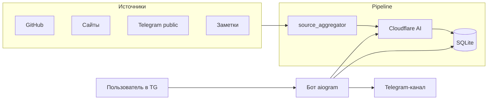

# QuestGuideRF AI Content Bot

Telegram-бот — AI-контент-менеджер для канала про квесты, городские прогулки, travel-tech и проект QuestGuideRF. Собирает материалы из настроенных источников, прогоняет их через **Cloudflare Workers AI**, помогает оформлять посты и публиковать их в канал.

## Возможности MVP

| Область          | Что уже есть                                                                                                                                             |
| ---------------- | -------------------------------------------------------------------------------------------------------------------------------------------------------- |
| **Ручной режим** | «Новый пост» / «Улучшить текст»: сырой текст → выбор тона → готовый пост с заголовком, хэштегами и CTA                                                   |
| **Автосбор**     | Планировщик и кнопка «Собрать новости»: GitHub, сайты из списка, публичные страницы Telegram (`t.me/s/...`), локальный файл заметок                      |
| **AI pipeline**  | Суммаризация, классификация, оценка релевантности, генерация постов в форматах: новость/туризм, пост о проекте, смешанный (travel + tech + QuestGuideRF) |
| **Черновики**    | Сохранение текущего сгенерированного текста в черновик (SQLite)                                                                                          |
| **Публикация**   | Отправка в канал с HTML-разметкой, запись в историю публикаций                                                                                           |

Ограничения текущей версии: загрузка картинки в сценарии FSM помечена как задел (Publisher умеет отправлять фото, но полный UX «прикрепить обложку» ещё не подключён). Миграции Alembic не используются — схема создаётся через `create_all` при старте.

## Стек

- Python 3.11+
- [aiogram](https://docs.aiogram.dev/) 3.x
- [SQLAlchemy 2](https://docs.sqlalchemy.org/) + SQLite (`aiosqlite`)
- [httpx](https://www.python-httpx.org/), [Beautiful Soup](https://www.crummy.com/software/BeautifulSoup/)
- [Pydantic Settings](https://docs.pydantic.dev/latest/concepts/pydantic_settings/)
- [APScheduler](https://apscheduler.readthedocs.io/) — фоновый сбор по cron
- [Cloudflare Workers AI](https://developers.cloudflare.com/workers-ai/) (HTTP API)

## Структура проекта

```
QuestGuideRF AI Content Bot/
├── main.py                 # Точка входа: логирование, БД, polling, планировщик
├── core/                   # Конфиг, логирование, утилиты
├── bot/
│   ├── handlers/           # Команды и сценарии (FSM)
│   ├── keyboards/          # Reply-клавиатура главного меню
│   └── states/             # Состояния FSM
├── content/                # Стили тонов, шаблоны промптов (см. prompts.py)
├── services/               # pipeline, генерация постов, черновики, агрегатор
├── integrations/           # Cloudflare AI, GitHub API
├── database/               # Модели SQLAlchemy, репозитории, сессия
├── scheduler/              # Задачи по расписанию (автосбор)
└── storage/                # SQLite БД, локальные заметки (inbox.md)
```

Ключевые модули по ТЗ:

- `services/prompt_manager.py` — сборка промптов для разных задач
- `services/post_generator.py` — улучшение текста и генерация постов
- `services/source_aggregator.py` — источники (`BaseSource`, сайты, GitHub, Telegram, заметки)
- `services/draft_service.py` — черновики
- `integrations/cloudflare_ai.py` — клиент Workers AI (таймауты, ретраи)
- `services/publisher.py` — публикация в канал

## Поток данных (упрощённо)



## База данных (сущности)

Создаётся автоматически при первом запуске (`init_db`).

| Таблица               | Назначение                                                                  |
| --------------------- | --------------------------------------------------------------------------- |
| `users`               | Пользователи Telegram                                                       |
| `sources`             | Зарегистрированные источники                                                |
| `fetched_items`       | Нормализованные материалы с полями summary, tags, relevance, classification |
| `drafts`              | Черновики                                                                   |
| `generated_posts`     | Сгенерированные посты (тона, заголовок, хэштеги, CTA)                       |
| `publication_history` | История отправок в канал                                                    |
| `project_updates`     | Заготовка под события репозитория                                           |
| `notes`               | Заметки/идеи                                                                |

## Настройка окружения

1. Склонируйте или скопируйте проект, создайте виртуальное окружение:

```bash
python -m venv .venv
```

**Windows (PowerShell):**

```powershell
.\.venv\Scripts\Activate.ps1
pip install -r requirements.txt
```

**Linux / macOS:**

```bash
source .venv/bin/activate
pip install -r requirements.txt
```

1. Скопируйте пример переменных и заполните секреты:

```bash
copy .env.example .env
```

### Переменные `.env`

| Переменная                              | Описание                                                                                             |
| --------------------------------------- | ---------------------------------------------------------------------------------------------------- |
| `BOT_TOKEN`                             | Токен бота от [@BotFather](https://t.me/BotFather)                                                   |
| `CHANNEL_ID`                            | Канал для публикации (`@channel` или числовой id), бот должен быть администратором с правом постинга |
| `CF_ACCOUNT_ID`, `CF_API_TOKEN`         | Cloudflare: аккаунт и API-токен с доступом к Workers AI                                              |
| `CF_MODEL`                              | Идентификатор модели, например `@cf/meta/llama-3.1-8b-instruct`                                      |
| `GITHUB_REPO`                           | `owner/repo` для событий репозитория                                                                 |
| `DATABASE_URL`                          | По умолчанию `sqlite+aiosqlite:///./storage/app.db`                                                  |
| `LOG_LEVEL`                             | `INFO`, `DEBUG`, …                                                                                   |
| `TELEGRAM_ADMIN_IDS`                    | Список user id админов (через запятую или JSON-массив)                                               |
| `AUTO_FETCH_ENABLED`, `AUTO_FETCH_CRON` | Включить фоновый сбор и cron-выражение                                                               |
| `MAX_SOURCE_ITEMS`                      | Лимит материалов за один проход                                                                      |
| `NOTES_STORAGE_PATH`                    | Путь к файлу заметок (markdown/текст)                                                                |
| `WEBSITE_SOURCES`                       | URL сайтов через запятую                                                                             |
| `TELEGRAM_SOURCE_URLS`                  | Публичные страницы каналов, например `https://t.me/s/channelname`                                    |
| `PUBLISH_PREVIEW_ENABLED`               | Флаг для логики предпросмотра (если используется в коде)                                             |

## Запуск

```bash
python main.py
```

Бот поднимает polling и при необходимости планировщик автосбора. Логи настраиваются через `core/logging.py` и `LOG_LEVEL`.

**Миграции:** в MVP схема применяется через `Base.metadata.create_all`. Для продакшена имеет смысл подключить Alembic и Postgres — см. раздел ниже.

## Сценарий пользователя (пример)

1. `/start` — появляется главное меню (кнопки: «Новый пост», «Улучшить текст», «Собрать новости», …).
2. Пользователь нажимает **«Собрать новости»** — бот тянет источники, сохраняет элементы и показывает краткий список.
3. Выбирает **«Смешанный пост»** (или другой формат) — pipeline берёт релевантный `fetched_item` и генерирует пост через Cloudflare AI.
4. При необходимости правит вручную или жмёт **«Сохранить в черновики»** / **«Опубликовать в канал»**.

## Промпты и стили

Шаблоны задач (суммаризация, пост из новости, улучшение текста, пост о разработке, смешанный пост, короткая версия, заголовок, CTA) лежат в `content/prompts.py` и собираются через `services/prompt_manager.py`. Стили тонов для «Улучшить текст» — в `content/styles.py`.

## Пример фрагмента сгенерированного поста

*(иллюстрация формата; фактический текст зависит от модели и входных данных)*

> **Городские квесты и маршруты: зачем приложению нужна «живая» карта**
> Кратко: в тренде — персональные маршруты и геймификация прогулок. Для QuestGuideRF это значит: проще объяснять сложные сценарии подсказок и проверок.
> …
> #QuestGuideRF #квесты #traveltech

## Что развивать дальше

- Очереди задач (Celery / RQ) и отдельный worker для тяжёлого парсинга
- Redis / Postgres, Alembic, бэкапы
- Веб-админка для источников и модерации
- Аналитика охватов и A/B вариантов постов
- Автопостинг по расписанию с очередью
- Генерация и прикрепление обложек (Workers AI + image API или шаблоны)
- Полноценный FSM для картинок и превью перед отправкой

---

**Кратко:** скопируйте `.env.example` → `.env`, установите зависимости, выдайте боту права в канале и токены Cloudflare — запустите `python main.py`.

---

Автор: legenda  
Telegram: [@LEGENDA_SD](https://t.me/LEGENDA_SD)
